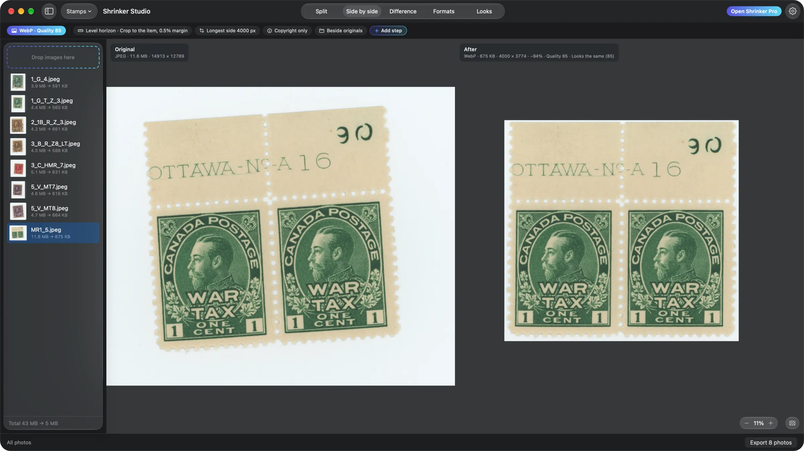
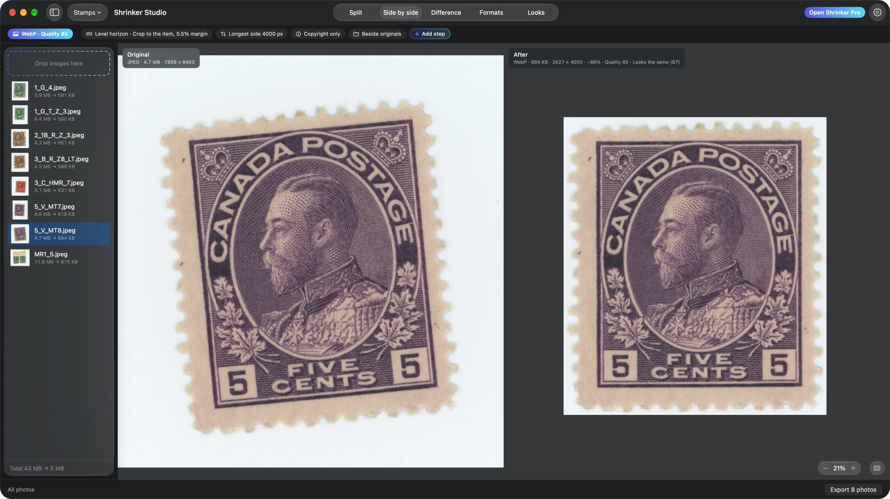
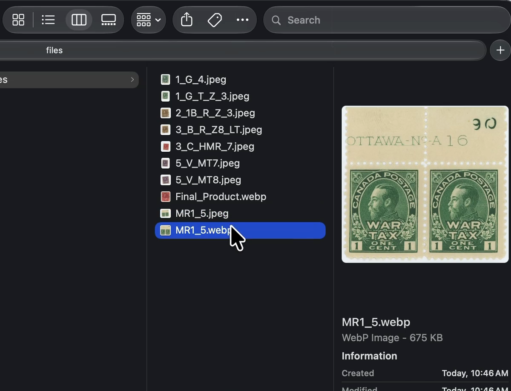

Hi everyone,

Shrinker Pro 1.9.0 is out, and Shrinker Studio picked up a new trick: **Straighten**.

**[Download Shrinker Pro](https://github.com/jeso87/ShrinkerPro/releases/latest/download/ShrinkerPro.dmg)**. Already have it? Choose **Check for Updates…**, or `brew upgrade --cask shrinker-pro`.

## Level the horizon

Add the **Straighten** step to a recipe and Studio finds the horizon in every photo and levels it. Great for a batch of travel shots. If it reads one photo wrong, **Straighten by hand…** lets you set that photo's angle yourself against a grid.

## Scans of stamps and prints

This part started with a pile of stamp scans, where losing even a sliver of the edge ruins the picture.

- **Keep the whole photo:** levelling doesn't cut anything off, so every perforation survives. The corners get filled with the scan's own background.
- **Crop to the item:** Studio levels the scan, then crops it right down to the stamp on the scanner glass, with a margin you pick (none up to 10%). Dust and hairs on the glass get ignored.

Here's a real one:

That's a 14,913 × 12,789 pixel scan, 11.6 MB, levelled, cropped and saved as a 4000 px WebP at 675 KB. Same recipe on a single 5¢:

## The clipboard trick

This one has been in Studio since 1.8, but I never really showed it off. Copy an image anywhere, press **⌃⌥⌘V**, then paste as usual. You get the smaller version, run through whichever recipe you like. In Finder, copying an 11.6 MB scan and pasting gave me a 675 KB WebP right there in the folder.

Pick the recipe and turn on **Use ⌃⌥⌘V in any app** in **Settings ▸ Studio ▸ Clipboard**. Without that, it's in the Edit menu as **Optimise Clipboard Image**.

## Also fixed

- **Side by side** no longer slides under the glass sidebars, and you can zoom out far enough to fit a huge scan.
- Dragging the quality slider with **All photos** chosen now saves with the recipe.

Shrinker Pro is still free. Studio comes with it, every tool works for your first 10 exports, and a one-time licence is at [shrinkerstudio.app](https://shrinkerstudio.app).
